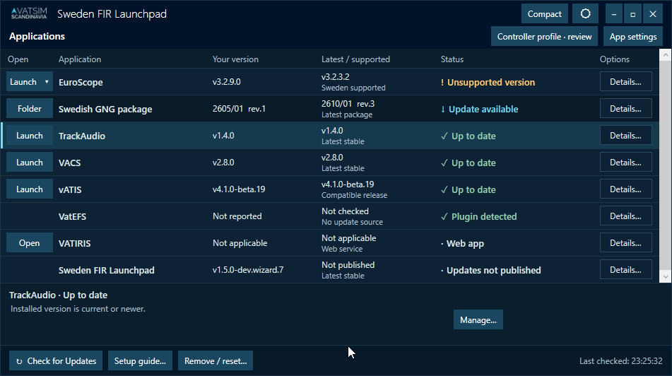

# VATSCA Launchpad

A Windows desktop app for [VATSIM Scandinavia](https://vatsca.org) controllers. Check versions, launch configured ATC tools, manage supported installations and share your saved controller details with EuroScope, vATIS and TrackAudio.

Launchpad supports reviewed installation and updates, optional controller-profile changes, and local recovery history. Downloads, installations and application launches always require an explicit action.

Latest release: **2.6.1** — 24 October 2026. See the [changelog](CHANGELOG.md) for what's new.



*Screenshot from an earlier version.*

## Install Launchpad

Use Windows 10 or 11 on an x64 PC. For installer [releases](https://github.com/Sjolus/vatsca-sweden-fir-launchpad/releases), download `SwedenFirLaunchpad-win-x64-Setup.exe`. Setup installs for your Windows user and creates a Start Menu shortcut. The installer and portable ZIP include .NET; framework-dependent builds require the [.NET 9 Desktop Runtime](https://dotnet.microsoft.com/en-us/download/dotnet/9.0). Setup can install WebView2 if it is missing. Microsoft Edge is used for the VatEFS and VATIRIS web-app windows.

The release packages use a self-signed development certificate. Windows may show an unknown-publisher or SmartScreen warning; this signature does not establish a publicly trusted publisher. Do not add the certificate to a trusted certificate store to suppress those warnings.

## Set up your tools

Open **Setup** to manage your applications, Swedish GNG package and controller profile. First launch shows a short guide in this same view, with a next step for each section. It resumes after restarting until you choose **Finish setup** or **Later**. Reopen it from **? → Getting started…**. Existing setups keep their saved locations; install only what you need.

1. **Applications:** find installed copies, change a location, or install a missing application. Saving a location keeps its existing configuration.
2. **Swedish GNG:** choose your data folder, get or update the package, and check fonts. File changes are reviewed before installation.
3. **Controller profile:** enter your details once. **Save & apply** uses them for configured EuroScope, vATIS and TrackAudio copies. It also adds the latest Swedish vATIS profile when no automatic Swedish profile is present. Close the clients before applying; unsupported versions are left unchanged.

Fresh vATIS and TrackAudio installations reuse your saved controller details. TrackAudio still needs audio devices and PTT configured. vATIS updates the Swedish airport profile from its official source afterward; custom profiles are kept. Opening Setup alone changes nothing.

The **Apps** and **Setup** tabs stay visible. Preferences and Activity & recovery are sections in the same Setup sidebar. **Applications I don't use** in Preferences hides those tools from Apps and update reminders. Their paths, data and plugin choices stay unchanged; clear a checkbox to show a tool again. GNG, VatEFS and SAAMAN are grouped under EuroScope. The **?** in the title bar opens help, reporting and privacy controls.

Choosing a location checks program identity and expected folder contents without starting anything. Wrong or missing new selections must be corrected or cleared; unrecognised custom locations need your confirmation. Existing saved choices can stay while you change other preferences. These checks do not confirm client configuration or support for automatic updates/removal.

See [setup choices](docs/product-onboarding.md) for supported layouts and limitations.

## Everyday use

- **Check for Updates** checks versions. Downloads, installations and application launches require a separate action.
- Use **Launch** to start a configured tool. Running rows offer **Show** immediately and **Close…** with confirmation. **Start all…** and **Close all…** let you review and select applications first. Starting skips tools already running or marked Not used; closing sends normal requests so applications can ask you to save or disconnect. The EuroScope row shows the selected launch profile.
- Each row shows the relevant action, such as updating, retrying or opening setup. Progress stays beside the application.
- Hover over a status to read the full message, or focus it with the keyboard and press **Ctrl+C** to copy it. Use **? → Report a problem…** to send a report.
- **Setup → Preferences** controls compact layout, text size and whether Launchpad stays on top of other windows. Choices save as you change them. Compact keeps equal-height rows; expanded layout adds a short explanation to every row.
- Window size, position, monitor and maximized state are remembered.
- **Setup → Activity & recovery** shows recent installation, update, removal and recovery outcomes, with the relevant recovery folders. A recent-operation notice also links here. GNG recovery still requires its normal review and confirmation.
- Edit your details under **Setup → Controller profile**, then choose **Save & apply**. VatEFS and SAAMAN switches are under **Setup → Applications**. The **ⓘ** buttons explain each option; open them with the mouse or keyboard.

The profile sync indicator checks only the first matching `ES*.prf`. A blank Hoppie code leaves existing Hoppie files unchanged; the preview says so.

## Install or update ATC software

| Application | Supported route |
| --- | --- |
| EuroScope | Open **Setup → Applications**, then **Install…** for a missing copy or **Manage…** for an existing one. Install, repair or switch to the pinned **3.2.3.2** token-authentication build. Existing installations need a recovery folder; switching from a higher version is a downgrade. |
| VACS | Update recognized 2.x NSIS installations; fresh setup uses an all-users installation. A per-user installer that requires elevation must be handled manually. |
| TrackAudio | Install or update a recognized current-user installation. |
| vATIS | Update the recognized standard per-user layout, with a complete recovery backup. Fresh setup supports the reviewed beta.19 package only after explicit beta opt-in, and refuses an existing installation/data folder. |
| Swedish GNG package | Choose **Setup → Swedish GNG → Get / update package…** to sign in on AeroNav, download or import a ZIP, review the changes and install. |
| VatEFS | Install missing copies and update recognized all-users MSI installations in Program Files, including official prereleases. Close EuroScope and the VatEFS backend first. The browser launch stays available when its local service is running. |
| SAAMAN | Install or update the latest stable Arlanda arrival-manager plugin, or choose an existing `SAAMAN.dll`. Optional profile integration puts it first in APP/ACC and replaces MAESTRO's entry. Close EuroScope before making changes. |
| Other custom tools | Configure their paths; installation remains manual. |

Close the target application first. Launchpad downloads and verifies the official package, then shows installation status. Its supported installer routes do not request normal client launch. Windows elevation and prerequisite prompts may still appear.

Downloads and preparation can be cancelled. Once installation starts, wait for it to finish; other setup/profile changes and Launchpad's Close action are blocked. Finish the operation before uninstalling through Windows. If an installer requests a Windows restart, restart before further maintenance; the notice and guard last for the current Launchpad session.

Unknown layouts, unsupported helper versions or missing prerequisites may require manual installation. After a failed update, check again before retrying. Do not run vATIS Setup over an existing data folder.

Read [client update support](docs/third-party-updates.md) and [EuroScope management](docs/euroscope-management.md) for the detailed restrictions and recovery steps.

### SAAMAN in APP/ACC

Under **Setup → Applications**, switch on **Use in APP / ACC** beside SAAMAN. Launchpad installs the latest stable DLL if needed, then enables it in `ESAA APP ACC.prf`. SAAMAN loads first and replaces MAESTRO's entry. Other plugins and display settings stay in place. The option starts off; an existing custom profile selection is retained.

Use **Location…** to select a moved DLL; its profile reference follows the new location. **Use existing…** selects a copy if none is configured. Switch SAAMAN off to restore MAESTRO, without a download. **Update** installs a newer stable release. Previous DLLs can be restored from **Setup → Activity & recovery**. See the [SAAMAN controller guide](https://github.com/Kaskobiii/SAAMAN/blob/main/docs/controller-guide.md) for using the plugin.

The profile-only action does not save controller credentials. GNG updates retain the chosen integration in their review. Turning it off removes SAAMAN and restores the original MAESTRO entry, order and display permissions when Launchpad replaced it. Other profile changes stay in place; this does not roll back the whole profile or create a MAESTRO entry if none existed. Leaving the option untouched preserves independently configured plugins. DLL updates and profile changes keep separate recovery copies; SAAMAN's own preferences stay in place.

## Remove applications or reset data

Open **Setup → Activity & recovery → Remove / reset…**. Select application removal and settings/data deletion separately, review the paths, then confirm. A private recovery export is enabled by default and is required for some preservation choices. Windows uninstall preselects Launchpad itself; other removal choices start unchecked.

Keeping vATIS or GNG settings when removing the application/package means saving an external export and restoring it manually. GNG reset removes the reviewed package and its personal files. VatEFS removal covers the configured DLL; its profile references need manual repair. Follow the export's `RESTORE.txt` if recovery is needed.

After a removal failure, selections are cleared and discovery refreshes before another review, unless Windows requires a restart. A completed export is retained. Removing Launchpad alone keeps ATC clients, shared runtimes and Launchpad's separate data folders. Its interactive Windows uninstaller offers the same review; native quiet uninstall keeps the separate data.

See [removal and recovery](docs/uninstallation.md) before a clean reinstall.

### Install GNG and clean up old files

Choose **Setup → Swedish GNG → Get / update package… → Download Swedish GNG**. Launchpad chooses Update Only for a recognized existing installation, or Full Package for setup or repair, then downloads the newest matching ZIP after AeroNav sign-in. You can also import an original ZIP downloaded through your browser. Review the destination, replacements and preservation notes before confirming installation. Launchpad backs up replaced files, keeps supported personal settings, and promotes staged plugin DLLs while EuroScope is closed. Read [GNG installation and recovery](docs/gng-updates.md) before your first update.

Unchanged files are hidden by default, and file comparisons show the expected result before installation. The comparison view highlights additions and removals and offers **Next change**. **Keep my list positions and visibility** is enabled by default; list items, columns and sorting still come from the new package. Validated cached packages are reused when the current AIRAC and revision match, without another download or sign-in.

Managed updates also download a matching complete ZIP as a cleanup reference, without installing its extra files. The result offers optional cleanup using the saved old and new complete ZIPs, subject to verification against installed files. The first managed installation may still need your original old ZIP. Review and select eligible files to move into a dated backup; nothing is selected or moved automatically. **Setup → Swedish GNG** also offers **Check fonts…** and **Clean up old files…**. Modified and referenced files are kept. This is separate from removing the whole GNG package; see [cleanup and recovery](docs/gng-cleanup.md).

## Update Launchpad

Installed copies use the action beside the **Sweden FIR Launchpad** row to download an update, then restart to apply it. The app follows this repository's stable Windows feed. A staged update is not applied automatically at startup; reopen Launchpad and check again to recover its ready state.

Portable and standalone copies use the [release-page download](https://github.com/Sjolus/vatsca-sweden-fir-launchpad/releases) instead. Use that page if no compatible feed is published or an in-app update cannot proceed. Close other dialogs and finish maintenance before restarting to update.

## Data and privacy

Reporting has three independent choices: **usage statistics**, **software and plugin versions**, and **automatic error reports**. Both existing and new users are asked when no choice has been saved. The switches are selected initially, but nothing is sent until you choose **Save choices**. Saving all three off is remembered and stops the prompt from returning. **Not now**, Escape or closing the dialog leaves the choice for a later launch and sends nothing. **Help → Privacy and support ID…** lets you change those choices, copy your support ID, generate a new ID or clear unsent reports. Existing reporting preferences do not automatically enable the new version-sharing category.

The random support ID stays the same across updates. Usage covers Launchpad sessions and version, screens visited, setup and maintenance results, application start requests and display preferences. It does not measure time spent controlling or VATSIM connectivity. Optional inventory covers configured ATC application versions, GNG revision and recognised EuroScope plugins. Plugin presence does not establish that it is enabled or running, and missing version metadata stays unknown. Errors contain fixed categories, the online service involved and its HTTP status where available. Application-version context requires version sharing.

Reports exclude names, CID, credentials, file paths, profile contents and browser sign-ins. Plugin collection reads metadata without loading DLLs; neither DLL contents nor arbitrary filenames are uploaded. Changing the support ID clears queued reports, saved sent copies and local context; already received reports remain under the old ID until they expire.

**Detailed DLL inventory** is an additional choice under software inventory. It includes every DLL found within the bounded scan of your configured plugin folders, including unrecognized DLLs. It shares recognized product names, versions, file fingerprints and copy counts; filenames, paths and file contents stay on your PC. Existing reporting choices do not enable this extra option. It is selected initially on the first consent prompt, but nothing is sent until **Save choices**. Current and staged copies are shown separately, and incomplete scans are marked.

Where supported, Launchpad reads the version a DLL is built to register with EuroScope. Otherwise it uses the DLL's version metadata or a recognised embedded release label. The Windows file version is shown separately; it can differ from the plugin version and from the GNG or installer release. Files without a readable version remain **Version unknown**. Unidentified DLLs still appear by fingerprint. **Not detected** means a known plugin was not found in the checked locations; **Unavailable** means those locations could not be reliably inspected. VatEFS uses its configured plugin folder when one is selected. This inspection does not run the DLL or establish that EuroScope has loaded it.

**Help → Last sent reports…** shows the most recent confirmed send for each reporting type, including manually submitted problem reports. Read the contents in plain language or expand the exact JSON. Confirmation times and records awaiting confirmation are shown separately. These local copies start with this feature; earlier sends are not available here. Launchpad keeps one copy per type within its bounded reporting storage. Turning sharing off retains those past copies; generating a new support ID removes them. Refresh reads local storage without sending anything.

**Help → Report a problem…** works independently of background reporting. Choose the application and problem category, review the exact information, then send or save it locally. There are no contact fields, free-text descriptions or attachments. Keep the returned reference if you want to discuss the report with the maintainer. Reporting uses `launchpad.space.sjolus.org`; see its [privacy details](https://launchpad.space.sjolus.org/privacy) for storage and retention.

| Location | Contents |
| --- | --- |
| `%LOCALAPPDATA%\SwedenFirLaunchpad` | Managed Launchpad installation |
| `%APPDATA%\VatscaUpdateChecker` | Preferences, controller identity fields, logs and dedicated VatEFS/VATIRIS browser profiles |
| `%LOCALAPPDATA%\VatscaUpdateChecker` | Downloaded packages, recovery backups and the dedicated AeroNav browser session |
| Windows Credential Manager | Launchpad's saved VATSIM password and Hoppie code |
| `%LOCALAPPDATA%\VatscaUpdateChecker\Reporting` | Reporting choices, random support ID, bounded pending automatic reports and the latest confirmed copy of each report type |

Profile sync writes the password and Hoppie code into the external tools' text files. Those files and recovery exports can contain plain-text credentials; keep them private. **Delete saved credentials** removes only Launchpad's two Credential Manager entries, not copies in profiles or backups. Credential Manager secrets are not exported.

The Activity view keeps up to 100 outcomes locally under `%LOCALAPPDATA%\VatscaUpdateChecker\Activity`. It stores application/action names, results, package versions and recovery locations, without profile contents or credentials. Preferences and logs reset removes this history; recovery backups are a separate choice.

vATIS update backups are under `%LOCALAPPDATA%\VatscaUpdateChecker\SoftwareUpdates\Backups`. Keep the complete folder, including its manifest and `RESTORE.txt`; Launchpad does not automatically delete these backups.

Launchpad keeps GNG browser data, temporary downloads and installation history in separate folders under `%LOCALAPPDATA%\VatscaUpdateChecker\Gng`. Deleting cached downloads leaves installation backups and original packages intact; deleting recovery backups removes that history. See [GNG storage and recovery](docs/gng-updates.md#storage-and-recovery).

Version checks use GitHub, `vatis.app` and `files.aero-nav.com`. Explicit setup/download actions also contact vendor and Microsoft download hosts. VatEFS opens `http://localhost:17770`; VATIRIS opens `vatiris.se`. See [SECURITY.md](SECURITY.md) for security reporting.

## Building from source

Build on Windows with the .NET 9 SDK:

```powershell
dotnet build vatsca-update-checker.sln -c Release
```

See [CONTRIBUTING.md](CONTRIBUTING.md) for tests, packaging and pull requests.

Licensed under [GPL v3](LICENSE).
